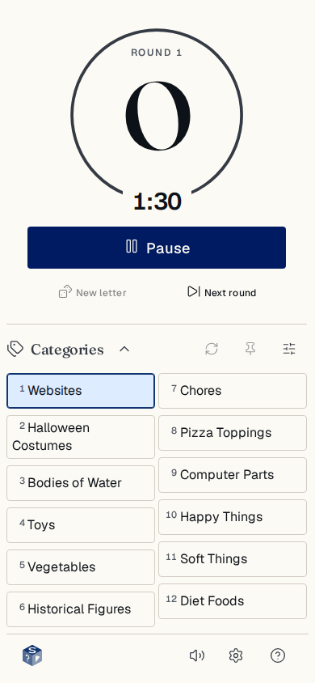
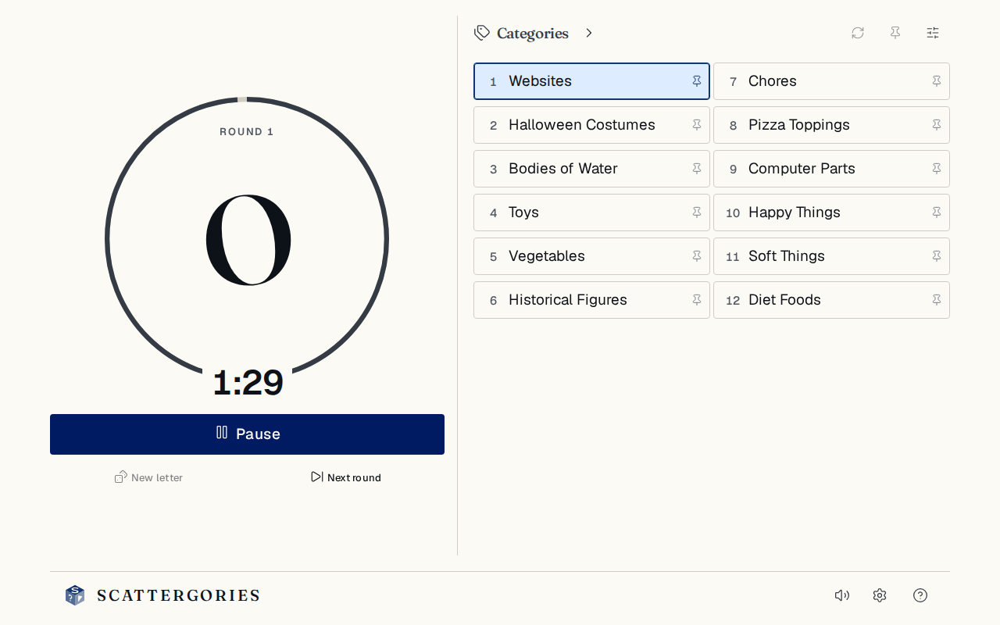

# Scattergories

[](https://github.com/simonvanlierde/scattergories/actions/workflows/ts.yml)
[](https://codecov.io/gh/simonvanlierde/scattergories)
[](LICENSE)
[](https://scattergories.duinlab.nl)
[](https://scattergories.duinlab.nl)

An unofficial companion for playing Scattergories at the table, in your browser. It rolls the
letter, draws the categories and runs the timer. For letter-and-timer play with your own
categories, fold the category panel using its chevron or press **C**. The app remembers whether
the panel is folded and keeps your saved deck. It's a single-page React app with no backend.

Scattergories is a party game by Hasbro. This project is not affiliated with or endorsed by
Hasbro.

**Live demo:** [scattergories.duinlab.nl](https://scattergories.duinlab.nl)

<picture><source media="(prefers-color-scheme: dark)" srcset="docs/screenshots/phone-dark.png"></picture>
<picture><source media="(prefers-color-scheme: dark)" srcset="docs/screenshots/desktop-dark.png"></picture>

Letters come from each language's own alphabet, weighted by how often each letter starts a word, in
9 fully translated languages. No account, no server: settings and custom category packs stay in
your browser.

## Quick start

Install [Node and pnpm](https://nodejs.org/en/download) (pinned versions:
[Prerequisites](.github/CONTRIBUTING.md#prerequisites)), then:

```bash
pnpm install
pnpm dev          # http://localhost:5173
pnpm build        # static build to dist/
```

The repository configures Cloudflare Workers for production and pull request previews.
[Deployment setup and the Pages migration](docs/architecture.md#deployment) describe the required GitHub environments and secrets.
You can also serve `dist/` on a static host with a fallback to `index.html`.

The app serves English privacy and accessibility statements at `/privacy` and `/accessibility`.
Open **How to play** to find links to both pages. Their source is in
[`docs/privacy.md`](docs/privacy.md) and [`docs/accessibility.md`](docs/accessibility.md).

## Social card

`public/og.png` is the 1200x630 card shown when the link is shared. It is made with the generator in
[my site repo](https://github.com/simonvanlierde/simonvanlierde.github.io/tree/main/scripts/social-card)
(needs Docker). The mark above the name is the app icon; the visual is the round's whole dial, letter, ring and timer, captured at 3x by `tests/shots/readme.spec.ts` (`just ts-shots` rewrites `docs/screenshots/og-dial.png`). From a checkout of that repo, with this repo next to it:

```sh
pnpm gen:card --mark ../scattergories/public/icons/icon-512.png \
  --visual ../scattergories/docs/screenshots/og-dial.png --name "Scattergories" \
  --line "An unofficial Scattergories companion: roll a letter, draw the categories and time the round." \
  --domain scattergories.duinlab.nl --out ../scattergories/public/og.png --fit contain
```

## Links

- [Architecture and deployment](docs/architecture.md), [decision records](docs/adr/)
- [Quality checks](docs/quality.md)
- [Contributing](.github/CONTRIBUTING.md)
- [Locale tools](tools/README.md)

## License

[MIT](LICENSE) © Simon van Lierde
