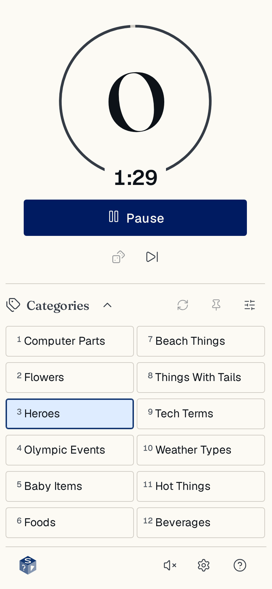
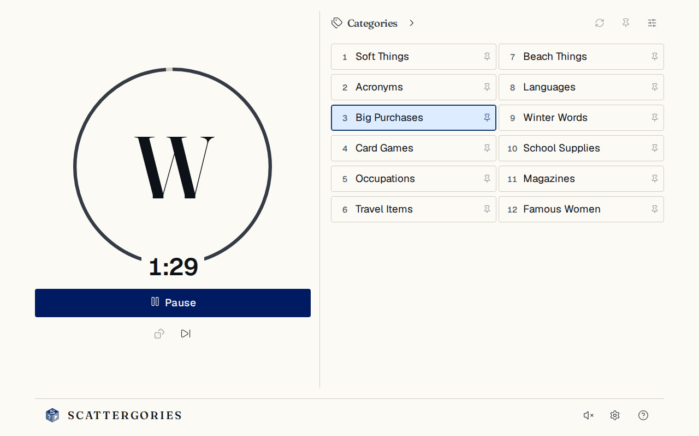

# Scattergories

[](https://github.com/simonvanlierde/scattergories/actions/workflows/ci.yml)
[](https://codecov.io/gh/simonvanlierde/scattergories)
[](LICENSE)
[](https://scattergories.duinlab.nl)
[](https://scattergories.duinlab.nl)

An unofficial companion for playing Scattergories at the table, in your browser. It rolls the
letter, draws the categories and runs the timer. It's a single-page React app with no backend.

Scattergories is a party game by Hasbro. This project is not affiliated with or endorsed by
Hasbro.

**Live demo:** [scattergories.duinlab.nl](https://scattergories.duinlab.nl)

<picture><source media="(prefers-color-scheme: dark)" srcset="docs/screenshots/phone-dark.png"></picture>
<picture><source media="(prefers-color-scheme: dark)" srcset="docs/screenshots/desktop-dark.png"></picture>

Letters come from each language's own alphabet, weighted by that language's letter frequencies, in
9 fully translated languages. No account, no server: settings and custom category packs stay in
your browser.

## Quick start

Install [Node and pnpm](https://nodejs.org/en/download) (pinned versions:
[Prerequisites](CONTRIBUTING.md#prerequisites)), then:

```bash
pnpm install
pnpm dev          # http://localhost:5173
pnpm build        # static build to dist/
```

Deploy `dist/` to any static host with an SPA fallback to `index.html`.

## Links

- [Architecture and deployment](docs/architecture.md), [decision records](docs/adr/)
- [Quality checks](docs/quality.md)
- [Contributing](CONTRIBUTING.md)
- [Locale tools](tools/README.md)

## License

[MIT](LICENSE) © Simon van Lierde
