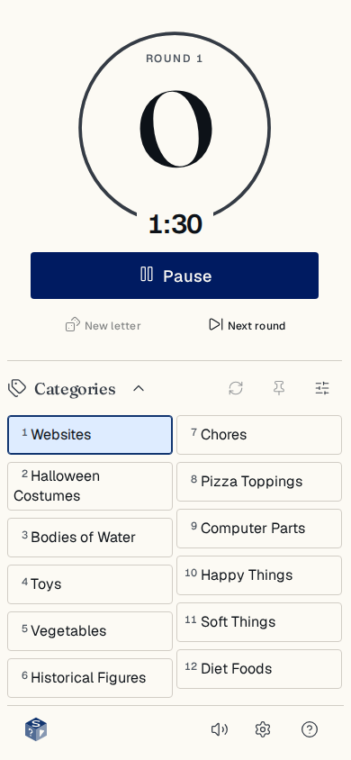
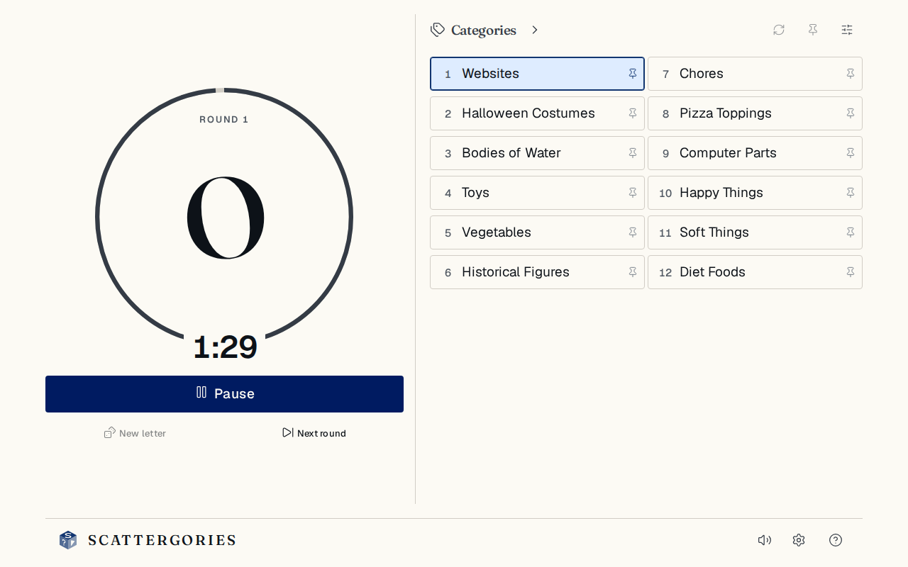

# Scattergories

[](https://github.com/simonvanlierde/scattergories/actions/workflows/ts.yml)
[](https://codecov.io/gh/simonvanlierde/scattergories)
[](LICENSE)
[](https://scattergories.duinlab.nl)
[](https://scattergories.duinlab.nl)

An unofficial Scattergories web app for playing at the table. It rolls the letter, draws the
categories and runs the timer. Players write their answers on paper.

**Play:** [scattergories.duinlab.nl](https://scattergories.duinlab.nl). Open it on a phone and tap to
roll. Once it has loaded, it works offline.

Playing with the paper cards from the box? Fold the category panel with its arrow, or press **C**,
and the app only rolls the letter and runs the timer. The app remembers that choice and keeps your
saved deck.

Scattergories is a party game by Hasbro. This project is not affiliated with or endorsed by
Hasbro.

<picture><source media="(prefers-color-scheme: dark)" srcset="docs/screenshots/phone-dark.png"></picture>
<picture><source media="(prefers-color-scheme: dark)" srcset="docs/screenshots/desktop-dark.png"></picture>

The app is translated into nine languages: English, Spanish, French, German, Italian, Dutch,
Polish, Portuguese and Greek. Each one rolls letters from its own alphabet, and a letter that starts
more words in that language's Wikipedia comes up more often. It's a single-page React app with no
accounts and no application server, so your settings and custom categories stay in your browser.

## Quick start

Install [Node and pnpm](https://nodejs.org/en/download) (pinned versions:
[Prerequisites](.github/CONTRIBUTING.md#prerequisites)), then:

```bash
pnpm install
pnpm dev          # http://localhost:5173
pnpm build        # static build to dist/
```

Production and pull request previews run on Cloudflare Workers.
[Deployment setup](docs/architecture.md#deployment) lists the GitHub environments and secrets they need.
Any static host can serve `dist/` too, as long as it falls back to `index.html`.

The privacy and accessibility statements are at `/privacy` and `/accessibility`, in English. The links and buttons around them follow your language.
The app renders them from [`docs/privacy.md`](docs/privacy.md) and
[`docs/accessibility.md`](docs/accessibility.md).

## Social card

`public/og.png` is the 1200x630 image that shows when someone shares the link. Its source is
[docs/og-card.html](docs/og-card.html), which uses the app's tokens and fonts.

```sh
just og-card-capture   # capture the dial from the app, light and dark
just og-card           # render docs/og-card.html to public/og.png
```

`just og-card --option dark --out file.png` draws the dark version.

## Links

- [Architecture and deployment](docs/architecture.md), [decision records](docs/adr/)
- [Quality checks](docs/quality.md)
- [Contributing](.github/CONTRIBUTING.md)
- [Locale tools](tools/README.md)

## License

[MIT](LICENSE) © Simon van Lierde
