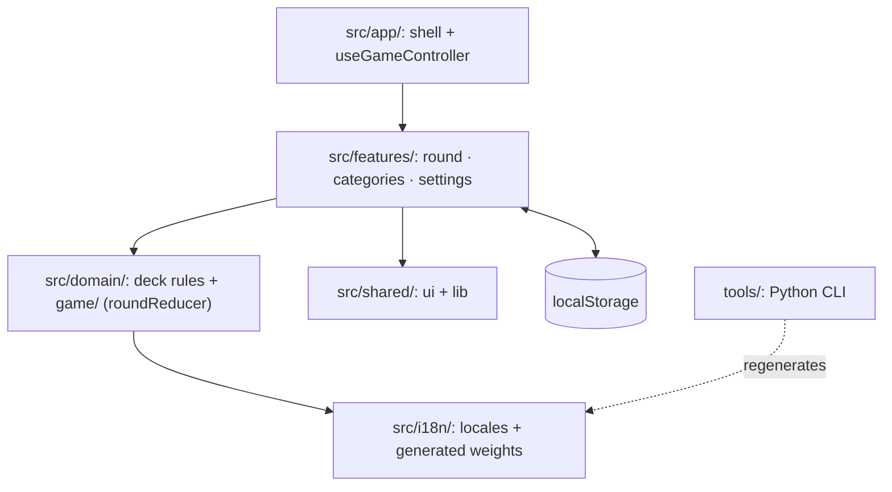
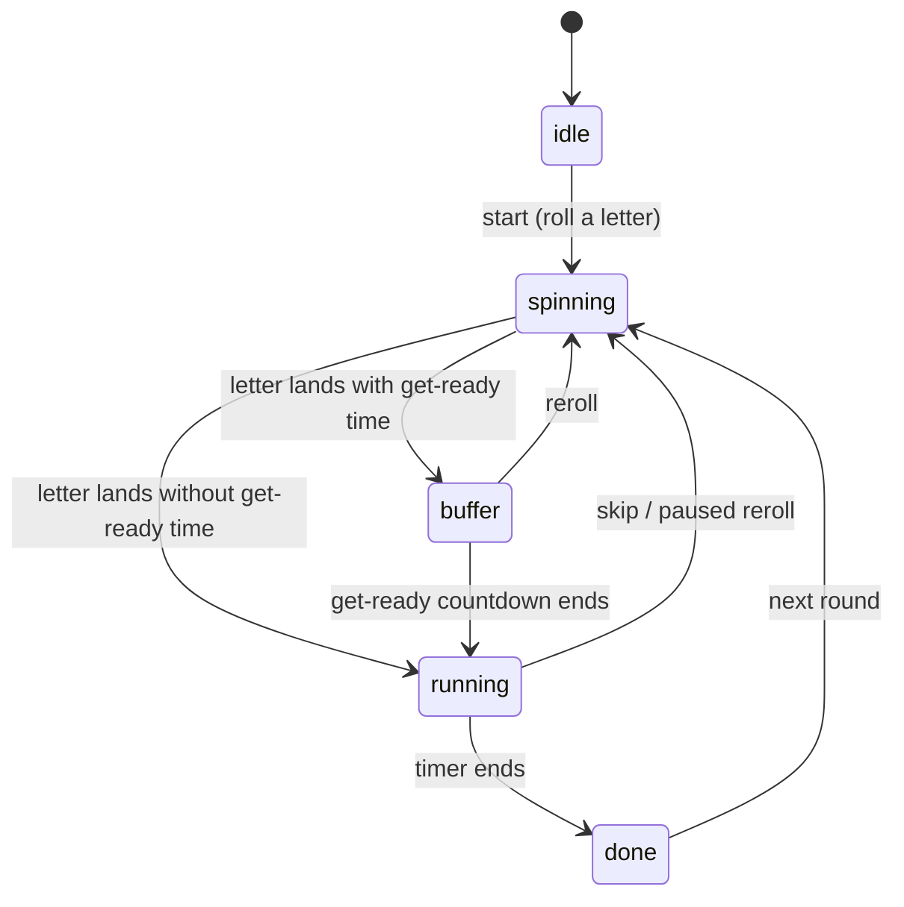

# Architecture

Scattergories is a single-page React app with no backend. Everything runs in the browser.
Settings and the deck are saved in `localStorage`. The current round and the session's round count stay in memory.
The only build input from outside the app code is the letter-weight table, which the Python CLI in `tools/` regenerates.

## Layers

The game rules never depend on React. The game screen calls the feature hooks only through `useGameController`. It renders each feature through its public component (`Playmat`, `CategoriesPanel`, `SettingsCluster`). The legal pages and the boot screen read the saved theme from `features/settings/` directly.

## Round state machine

A round runs on a `useReducer` in [`roundReducer.ts`](../src/domain/game/roundReducer.ts). The reducer is a pure function, so the unit tests check its transitions without rendering anything:

## Data flow

`useGameController` combines the feature hooks (`useRound`, `useCategoryBoard`, `useSettings`) and gives the shell one typed interface. The categories feature owns the drawn board: `features/categories/useCategoryBoard.ts` draws the categories for a round, and `CategoriesPanel` edits the saved deck through `useSettings` itself.

[`domain/deck.ts`](../src/domain/deck.ts) holds the deck rules as pure functions: the category packs, the default deck, and how a round's categories and letter are drawn. The letter draw uses each language's weights from `i18n/__generated__/letterWeights.json`, which `tools/` produces offline.

All saved state goes to `localStorage` through the `safeStorage` wrapper in `shared/lib`. `features/settings/` saves the settings and the deck, `i18n/` saves the language, and `app/useOnboarding.ts` saves whether the welcome screen is done. The app requests its files from the host and uploads nothing.

The decision records in [`adr/`](adr/) give the reasons for the main choices.

## Offline play

The production build gives the service worker two lists. The first holds what it caches before it
activates: the shell, English, the Latin fonts and static files. The second holds what it caches on
first use: other languages, other font subsets and store screenshots. Install also fetches the
language chunk for the browser's language, so the first visit works offline in that language. The
privacy and accessibility pages are served from the cached shell.

The worker only caches paths in those two lists. A failed download stops the install. So does a
script, stylesheet or font with the wrong content type (such as the host's HTML fallback). On first
use, such a response is not stored.

Each build has its own cache, named by build time. The worker keeps the current build and the one
before it, so tabs on the old build find their hashed files. It deletes older caches. A failed
install deletes its partial cache, so the last complete build stays. Hashed files under `/assets/`
come from the cache without a network refresh. A page load waits 3.5 seconds for the network before
using the cached shell.

## Translations

Translations live in `src/i18n/locales/*.po`. Each catalog holds the UI messages and
category labels, and `en.po` holds the English source text. Message IDs are the same in
every language, and placeholders use ICU syntax such as `{seconds}`.

Edit the catalogs by hand, then run `pnpm i18n:compile` to check them. Do not run
`lingui extract`: it cannot find symbolic and dynamic IDs, so it marks valid messages
obsolete. Vite compiles the catalogs at build time. English is always loaded, as the
offline fallback, and other languages load when needed.

## Deployment

A Cloudflare Worker serves `dist/` as static assets, with a fallback to `index.html`. [`wrangler.jsonc`](../wrangler.jsonc) names the Worker and its asset directory.
[`public/_headers`](../public/_headers) sets the security headers.

The [`ts` workflow](../.github/workflows/ts.yml) deploys the checked build after a push to `main`.
Production waits for the app checks and browser tests. Human pull requests from this repository can
receive separate `scattergories-pr-<number>` previews. Fork and bot pull requests skip previews.
The [retirement workflow](../.github/workflows/preview-retire.yml) deletes previews when their pull
request closes or becomes a draft, and sweeps daily for missed deletions.

Without deployment credentials, these workflows print a notice and skip deployment.

### Set up Workers

1. Create GitHub environments named `preview` and `production` in the repository's **Settings → Environments**.
   Limit `production` deployment branches to `main`. Let `preview` accept pull request refs.
   `just repo-settings` creates both environments and applies the other repository settings.
2. Add `CLOUDFLARE_API_TOKEN` and `CLOUDFLARE_ACCOUNT_ID` as secrets in each environment.
   The Cloudflare token needs Workers Scripts edit permission on the target account, and read
   access to that account's Workers subdomain.
3. Merge the deployment configuration to `main` and wait for its production job to pass.
   Check the reported `workers.dev` address: start a round, reload `/privacy` and `/accessibility`,
   and check the security headers. Open a pull request from a branch here (not a bot or a fork) to
   check that a preview is created and later deleted.
4. Add `scattergories.duinlab.nl` to the Worker's custom domains in Cloudflare.
   Check HTTPS, the home page, legal routes and security headers on the custom domain.

To deploy from your own machine with the credentials set up, run `pnpm build`, then `pnpm exec wrangler deploy`.
