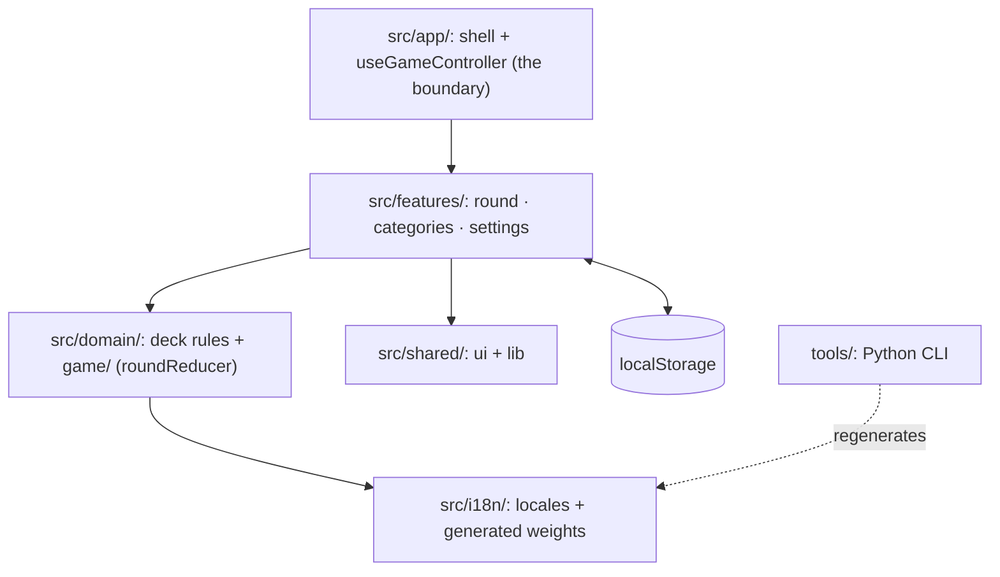
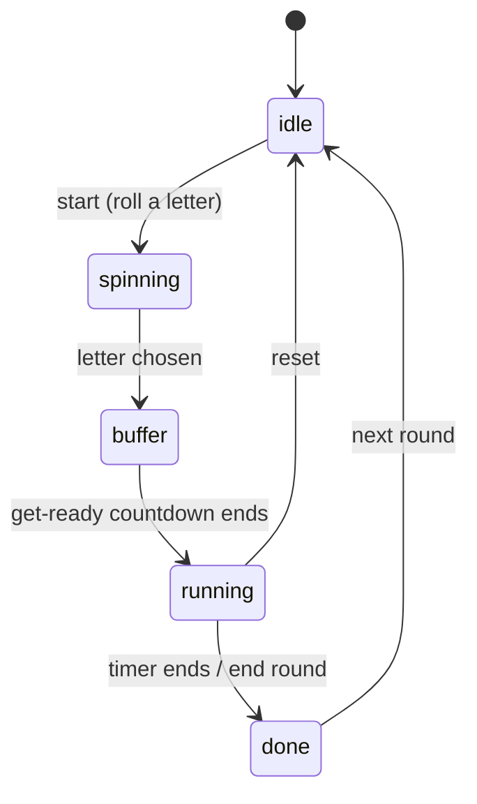

# Architecture

Scattergories is a single-page React app with no backend. Everything runs in the browser and is saved to `localStorage`. The only build-time input from outside the app is the locale asset bundle, which the Python `tools/` package regenerates.

## Layers

The source is layered so the game rules never depend on React, and the UI never reaches past the `useGameController` boundary into feature internals.

## Round state machine

A round runs on a `useReducer` in [`roundReducer.ts`](../src/domain/game/roundReducer.ts). The reducer is pure, so its transitions are unit-tested without rendering anything:

## Data flow

`useGameController` combines the feature hooks and gives the shell a single typed interface. The deck rules live in one pure module, [`domain/deck.ts`](../src/domain/deck.ts): the category packs, the default deck, how a round's categories are drawn, and how its letter is drawn. Letters are rolled with locale-aware weights from `i18n/__generated__/letterWeights.json`, which `tools/` produces offline. Settings and custom category packs are the only saved state. They are written to `localStorage` from `features/settings/`, through the `safeStorage` wrapper in `shared/lib`. Game settings and custom category packs stay in the browser. The browser requests app files from the host; the app does not upload game inputs.

The reasons for the key choices live in [`adr/`](adr/).

## Offline play

The production build gives the service worker a list of the shell and static assets. It caches
them before activation, including the documents and every language. Failed downloads or invalid
script and stylesheet responses prevent installation. Old content-hashed files remain available
to already-open tabs.

## Translations

Translations live in `src/i18n/locales/*.po`. Each catalog contains UI messages and
category labels, with the English text in the source catalog. Message IDs stay the
same across languages; interpolation uses ICU placeholders such as `{seconds}`.
The rules attribution uses numbered tags for its three links. Edit the catalogs
and run `pnpm i18n:compile` to check them. Vite compiles catalogs when building;
English is bundled for offline fallback, and other languages load on demand.

Catalogs are maintained by hand. Do not run `lingui extract`: symbolic and dynamic IDs
are not discoverable, so extraction marks valid messages obsolete.

## Deployment

The repository configures a Cloudflare Worker to serve `dist/` as static assets, with a fallback to
`index.html`. [`wrangler.jsonc`](../wrangler.jsonc) names the Worker and its asset directory.
[`public/_headers`](../public/_headers) sets the security headers.

The [`ts` workflow](../.github/workflows/ts.yml) deploys the checked build after a push to `main`.
Production waits for the app checks and browser tests. Human pull requests from this repository can
receive separate `scattergories-pr-<number>` previews. Fork and bot pull requests skip previews.
The [retirement workflow](../.github/workflows/preview-retire.yml) deletes previews when their pull
request closes or becomes a draft, and sweeps daily for missed deletions.

These workflows need deployment credentials before they can publish. Without them, they report a
notice and skip deployment. They do not migrate an existing Cloudflare Pages domain automatically.

### Set up Workers and migrate from Pages

Keep the Pages project and its production domain serving traffic until the Worker has passed the checks below.

1. Create GitHub environments named `preview` and `production` in the repository's **Settings → Environments**.
   Limit `production` deployment branches to `main`. Previews need to accept pull request refs.
   The maintainer's `just repo-settings` recipe creates these environments and applies the repository's other settings.
2. Add `CLOUDFLARE_API_TOKEN` and `CLOUDFLARE_ACCOUNT_ID` as secrets in each environment.
   Use a Cloudflare token with Workers Scripts edit permission for the target account.
   The deployment scripts also need to read that account's Workers subdomain.
3. Merge the deployment configuration to `main` and wait for its production job to pass.
   Check the reported `workers.dev` address: start a round, reload `/privacy` and `/accessibility`,
   and check the security headers. Open a human pull request to verify preview creation and retirement.
4. Move `scattergories.duinlab.nl` from Pages to the verified Worker's custom domains in Cloudflare.
   Plan the domain reassignment before changing the Pages binding. Keep the Pages project available for rollback.
   Check HTTPS, the home page, legal routes and security headers on the custom domain before retiring Pages.

For a local deployment after credentials are configured, run `pnpm build`, then `pnpm exec wrangler deploy`.
