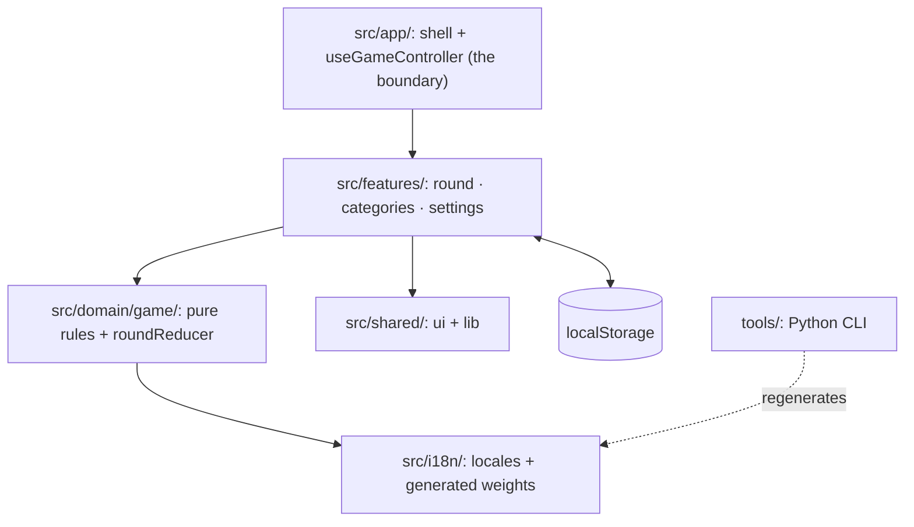
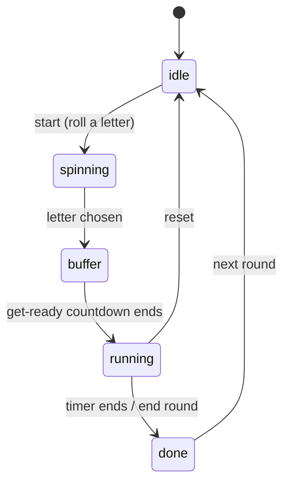

# Architecture

Scattergories is a single-page React app with no backend. Everything runs in the browser and is saved to `localStorage`. The only build-time input from outside the app is the locale asset bundle, which the Python `tools/` package regenerates.

## Layers

The source is layered so the game rules never depend on React, and the UI never reaches past the `useGameController` boundary into feature internals.

## Round state machine

A round runs on a `useReducer` in [`roundReducer.ts`](../src/domain/game/roundReducer.ts). The reducer is pure, so its transitions are unit-tested without rendering anything:

## Data flow

`useGameController` combines the feature hooks and gives the shell a single typed interface. Letters are rolled with locale-aware weights from `i18n/__generated__/letterWeights`, which `tools/` produces offline. Settings and custom category packs are the only saved state. They are written to `localStorage` from `features/settings/`, through the `safeStorage` wrapper in `shared/lib`. There is no network call at runtime, and nothing leaves the device.

The reasons for the key choices live in [`adr/`](adr/).

## Deployment

Cloudflare Pages builds and publishes the site on every push to `main`. The build and preview
settings live in the Cloudflare dashboard. The repo only pins the output directory, in
[`wrangler.jsonc`](../wrangler.jsonc).

To deploy from a local checkout, run `pnpm build && pnpm dlx wrangler pages deploy dist`.
